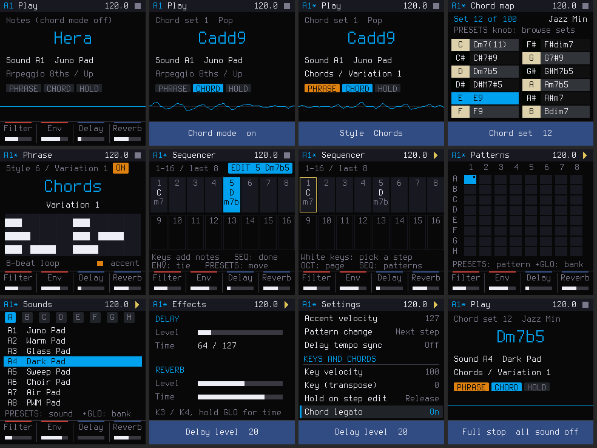
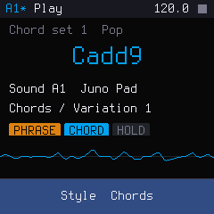
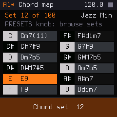
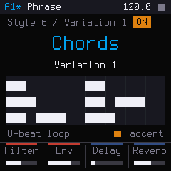
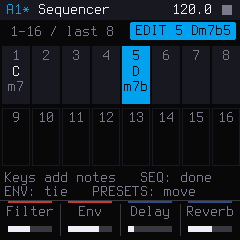
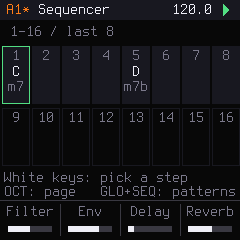
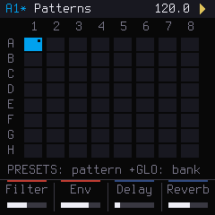
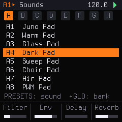
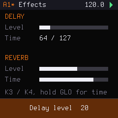
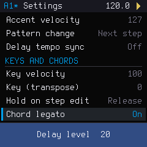

# HERA: a chord groovebox for the M-VAVE FM-1

**The workflow of the Roland AIRA Compact J-6, rebuilt for the FM-1, with a real screen to show it.**

*An independent project. Not made, endorsed or supported by Roland.*

**[Play it in your browser](https://benbadio.github.io/hera-fm1/)** · [Manual](https://benbadio.github.io/hera-fm1/manual.html) · [Install on your FM-1](https://benbadio.github.io/hera-fm1/install.html) · Version 0.1 (identity `FM-1_951`), a preview before 1.0

HERA turns the FM-1 into a J-6-style chord machine:
- **100 chord sets**, each mapping a chord to every key.
- **9 phrase styles × 12 variations**: arpeggios, rhythms, and chord and strum phrases.
- **A 64-pattern step sequencer** with ties, per-step phrases, shuffle and real-time recording.
- **A Juno-style 4-voice synth** with delay and reverb.

Juno's Greek counterpart is Hera.

## How it compares with the J-6

| | Roland J-6 | HERA on the FM-1 |
|---|---|---|
| Chord sets | 100 | The same 100 voicings |
| Phrase styles | 9 × 12 variations | The same 9 × 12 (styles 6–9 timed from a J-6) |
| Sequencer | 64 patterns × 64 steps | The same, with 16 steps on screen at a time |
| Display | 4-character LED | 240 × 240 colour screen with plain-word menus |
| See which chord is on which key | No | Yes: the chord map page |
| Preview a phrase before playing it | No | Yes: a piano roll of the phrase |
| Keyboard | 13 keys | 27 keys (more than two octaves) |
| Full stop | Not documented | Hold PLAY: all sound off, with no click |
| Extra settings | — | Hold on step edit, Chord legato |
| Sound | Roland's JUNO-60 model (ACB) | An open-source Juno-style voice (after Clipper) |

It is an independent, clean-room recreation of the Roland J-6's *behaviour*. No Roland code, firmware or samples are used. The chord voicings come from the J-6 owner's manual, and the phrase timing for styles 6–9 was measured from a J-6 over MIDI (`capture/`, `tools/derive_phrases.py`). It is not made by, affiliated with or endorsed by Roland.

## Features

The FM-1's colour screen shows everything in plain words.
- **Top bar:** pattern (with `*` when unsaved), page name, tempo and transport.
- **Bottom bar:** what the four knobs do, or a short pop-up after any change.

The screenshots come from the host simulator (`tests/run_hera_host.sh`).

### Play

The home page.
- **The chord (or note) you just played, in large text.**
- The chord set and its genre.
- The sound.
- The phrase style and variation in words.
- Lights for PHRASE, CHORD and HOLD.

With a phrase running, a live **oscilloscope** shows the sound.

 

### Chord map

Which chord is on which key, something the J-6 can't show. Hold **SCL** to open it.
- Turn **PRESETS** to browse all 100 sets. The set number and genre sit at the top.
- Black keys are dark rows, white keys light rows, laid out like a keyboard.
- The key you play lights up, so you can audition every chord before choosing a set.

 

### Phrase

Turn **SELECT** for the style and **ALGORITHM** for the variation. Hold **ARP** to open the page.

For the chord and strum styles (6–9), a **piano roll** draws the actual phrase: the timing measured from a J-6, with accents in orange. You can see a variation's rhythm before you hear it.

 

### Sequencer

- **Layout:** 64 steps in 4 pages of 16, shown as a grid of chords and notes. Ties, per-step phrases (a green mark) and the last step are all visible. **OCT − / +** turns pages.
- **Entering steps:** pick a step with a white key, play keys to enter notes or chords, and press **SEQ** when done.
- **Moving and editing:** **PRESETS** moves to the next step. Holding **GLO** shows the step tools: copy, paste, insert, clear, double.

 

While it plays, a green frame follows the playhead. The key lights show which steps hold notes.

 

### Patterns

All 64 patterns, 8 banks × 8, on one grid (**GLO + SEQ**).
- **Shown:** the current pattern, patterns with notes, unsaved ones (a dot), and a queued next one (a green frame).
- **Choosing:** white keys 1–8 pick a pattern, and 9–16 pick a bank.

 

### Sounds

64 Juno-style sounds in 8 banks: pads, strings, brass, keys, bass, leads, plucks and effects (**LFO**). Choose them with **PRESETS** or the white keys.

The voice is after Clipper's Juno engine:
- saw, pulse and sub oscillators, plus noise;
- a 4-position high-pass;
- a 24 dB transistor-ladder filter;
- chorus I, II and I+II.

 

### Effects

Delay and reverb, each with a level and a time (**FX**). With tempo sync on, the delay time reads as a note value.

 

### Settings

Every J-6 menu item in plain words, grouped as Pattern, Keys and chords, MIDI, Sync and System (**EDIT**). Two settings are new in HERA: *Hold on step edit* and *Chord legato*.
- **PRESETS** chooses an item, and **K1** changes it.
- Leaving the page saves the settings.

 

## The Workbench (in your browser)

**Open it at [benbadio.github.io/hera-fm1](https://benbadio.github.io/hera-fm1/).** `web/` is the **HERA Workbench**, modelled on M-VAVE's FM1 Open Workbench:
- **The real firmware in the browser:** HERA compiled to WebAssembly on a virtual FM-1, playable with the mouse, the computer keyboard or a MIDI keyboard.
- **An editor** with tabs for sounds, chord sets (with every chord's notes), phrases (with piano rolls), the 64-step grid, settings, and projects (save in the browser, export / import files).
- **A guided tour** in the order of the J-6 manual. It highlights each control and moves on by itself when you've done the step.
- **A manual** (`manual.html`) with "to do this, press that" tables.
- **A Web MIDI installer** (`install.html`) for HERA and for restoring the factory V15.

To run it locally, build it with `sh web/build.sh` (needs LLVM with wasm32: `brew install llvm lld`), then serve `web/` with any static server, e.g. `python3 -m http.server --directory web`. CI also packages it as the `hera-workbench` artifact, and every push to `main` publishes it to GitHub Pages with the latest firmware in the installer.

## Using it

| FM-1 | HERA |
|---|---|
| **PLAY** | Tap: play / stop. **Hold**: full stop (all sound off). GLO + PLAY: play from the selected step |
| **REC** | Record (real time) |
| **SCL** | Tap: chord mode on/off. **Hold** (or GLO + SCL): the **chord map**, i.e. which chord is on which key |
| **ARP** | Tap: phrase (STYLE) on/off. Hold: the phrase page |
| **ENV** | HOLD (in step edit: tie) |
| **HOME / SEQ / LFO / FX / EDIT** | Pages: play, sequencer (GLO+SEQ: patterns), sounds, effects, settings |
| **SAVE** | Save the pattern (GLO + SAVE: all patterns) |
| **OCT − / +** | Octave (GLO: key transpose; on the sequencer page: steps page) |
| **K1–K4** | Filter, envelope (release), delay level, reverb level. GLO: resonance, attack, delay time, reverb time |
| **SELECT / ALGORITHM** | Phrase style / variation |
| **PRESETS** | Tempo, or whatever the page browses (chord sets, sounds, patterns, settings) |
| **Keys** | Notes, or chords in chord mode. On the sequencer page the white keys pick steps; then keys enter notes |

The settings page uses plain words: MIDI channel, clock source, hold on step edit, chord legato, count-in, tune and more. Leaving the page saves them.

## Building

- **GitHub Actions** (`.github/workflows/build.yml`, Ubuntu) builds `hera.fwsc` with JieLi's Linux toolchain and uploads it.
- **Releases:** the version lives in `VERSION` (now `0.1`; the identity is `FM-1_95` + the minor digit). Push a matching tag, e.g. `git tag v0.1 && git push origin v0.1`, and `.github/workflows/release.yml` builds and signs the package on GitHub with the Firmware Hub's shared workflow, then attaches `hera-0.1.fwsc` to the release.
- **Locally on Linux x86-64:**
  1. `tools/get_toolchain.sh`
  2. Clone the AC79 SDK (tag `AC79NN_SDK_V1.2.1_2023-12-13`) to `~/fw-AC79_AIoT_SDK`.
  3. Run `./build.sh`, which writes `build/hera.fwsc`.

Tests run on macOS or Linux:
- `tests/j6/run_tests.sh`: the engine (chords, phrases, sequencer, synth, glue), about 800,000 checks.
- `tests/run_hera_host.sh`: the whole firmware in a simulator. It writes a PNG of every page and a WAV of a scripted session to `build/hera/`.

## Installing

Install it like any open FM-1 firmware:
- the Web MIDI installer, or
- `python3 tools/fm1_install.py build/hera.fwsc`.

The factory V15 restore and the USB rescue (hold **OCT −** while switching on) stay available. HERA includes Felucca's update loader, so any other firmware, or V15, installs on top of it in the usual way.

### What HERA keeps

HERA keeps its 64 patterns and its global settings in its own area of the FM-1's flash (65 sectors of 4 KiB). It doesn't read the projects, presets or samples of V15 or of other firmwares. Installing another firmware can overwrite HERA's patterns, and there's no way yet to copy them off the FM-1, so treat patterns on the device as temporary for now.

## Credits and licence
GPL-3.0-only. See `LICENSING.md`.
