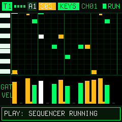

# MORPHEUS // M-VAVE FM-1 Pattern Sequencer & Synthesizer

<p align="center">
  <strong>4-Track Pattern Sequencer & Synthesizer, inspired by classic matrix pattern sequencers, featuring a built-in 303 Acid Synth Engine, Multi-Engine Sound Generator, and 240x240 Color LCD UI.</strong>
</p>

<p align="center">
  
</p>

MORPHEUS transforms the ultra-portable **M-VAVE FM-1** into a standalone hardware pattern sequencer workstation and synthesizer rack inspired by classic matrix pattern sequencers.

- 📖 **[User Manual](web/manual.html)** &bull; 💾 **[Installation Guide](web/install.html)** &bull; 🎛️ **[Live Web Demo](https://benbadio.github.io/morpheus-fm1/)** &bull; 🚀 **[The Firmware Hub](https://thefirmwarehub.com/)**

---

## Key Features

- **4 Simultaneous Independent Tracks (T1 – T4):**
  - Drive up to 4 external hardware synths, drum machines, or DAW tracks simultaneously over USB-MIDI and 3.5mm TRS-MIDI on distinct channels.
  - Per-track polyrhythmic sequence lengths (1 to 32 steps).
  - Independent step resolution (1/2, 1/4, 1/8, 1/16, 1/32, plus triplet modes 1/4T, 1/8T, 1/16T).
  - Global and per-track shuffle/swing (0% to 75%).
- **High-Contrast Matrix UI Emulation:**
  - Designed for the FM-1's 240x240 color LCD.
  - 120px 16-step grid with interactive piano roll view.
  - Dual modes: **KEYS** (Note Pitch + Velocity Bars + Tied Step Bridges) and **CURVE** (Bipolar/Unipolar CV Modulation Curves for filter cutoffs, automation, and MIDI CC).
  - Bank (A–D) & Pattern (1–8) selector with 32 patterns per track (128 total patterns).
  - Quick pattern operations: Shift Left/Right, Transpose Octave Up/Down, Randomize, Alter, Copy/Paste.
- **Built-in Multi-Engine Sound Generator (Real-time Q15 DSP):**
  - **303 Acid Bass Engine:** Non-linear resonant diode-ladder filter with saturation, accent overdrive, and portamento pitch slide across tied steps.
  - **Subtractive Lead/Chord Engine:** Dual-oscillator analog emulation with pulse-width modulation and 24dB ladder filter.
  - **2-OP FM Engine:** Dynamic frequency modulation for bells, metallic plucks, and FM percussion.
  - **MUTE Engine:** Zero-latency silent mode for pure MIDI sequencing to external hardware without internal audio overhead.
- **Factory Demo Grooves:**
  - Bank A pre-loaded with a cohesive 4-track acid techno / electronic groove:
    - **Track 1:** 303 Acid Bassline (MIDI Ch 1)
    - **Track 2:** Syncopated Synthesizer Lead (MIDI Ch 2)
    - **Track 3:** Arpeggiator (MIDI Ch 3)
    - **Track 4:** Drum Trigger Pattern (MIDI Ch 10 - Kick, Snare, Hi-Hat)
- **In-Browser Web Emulator:**
  - Interactive Web Audio demo in `web/` with SVG front panel, canvas LCD screen, draggable knobs, and 27 playable silicone keys.
  - Automatic deployment to GitHub Pages.

---

## Hardware Controls & Panel Mapping

| Hardware Control | Primary Function | With SHIFT / Secondary |
|---|---|---|
| **27 Silicone Keys** | Audition / Play notes, Step Record in REC mode | Step Jump (1-16 / 17-32) |
| **K1 (Cutoff)** | Synth Filter Cutoff / Active Step Note Pitch | Step Velocity |
| **K2 (Resonance)** | Synth Resonance / Active Step Gate Length | Step Tie (On/Off) |
| **K3 (Decay)** | Filter Envelope Decay / Curve Value | CC Modulation Depth |
| **K4 (Accent)** | 303 Accent Intensity / Pattern Length (1-32) | Track Resolution |
| **TEMPO Knob** | Sequencer Tempo (50 - 240 BPM) | Shuffle / Swing (0 - 75%) |
| **SELECT Knob** | Scrub Active Step (1 - 32) | Pattern Transpose (±12) |
| **PLAY** | Start / Stop Sequencer | Restart from Step 1 |
| **REC** | Step Record Mode (Audition + Step Advance) | Clear Active Step |
| **TRACK** | Switch Active Track (T1 -> T2 -> T3 -> T4) | Track Mute / Solo |
| **MODE** | Toggle KEYS (Notes) / CURVE (Modulation) | Curve CC Assignment |
| **SOUND** | Cycle Engine: 303 Acid -> SUB -> FM -> MUTE | Engine Parameters |
| **PAGE** | Toggle Page 1 (Steps 1-16) / Page 2 (Steps 17-32) | Set Pattern Length |
| **OCT- / OCT+** | Grid Octave Scroll (C1..B5) | Track Octave Transpose |
| **BANK / PAT** | Select Bank A–D / Pattern 1–8 | Pattern Copy / Paste |
| **SAVE** | Save all tracks & patterns to Flash / Storage | Reload from Flash |

---

## Testing & Host Mode Simulation

You can test MORPHEUS on your computer (macOS or Linux) without an FM-1 hardware device:

```sh
# Run host test suite (renders audio WAV and generates LCD screenshots)
./tests/run_host.sh
```

Outputs generated in `build/host/`:
- `morpheus.wav`: 44.1 kHz 16-bit stereo audio render of the 4-track sequencer.
- `morpheus-500.png`: LCD screenshot at 500 ms (Keys View).
- `morpheus-3500.png`: LCD screenshot at 3500 ms (Curve View).
- `morpheus-5000.png`: LCD screenshot at 5000 ms (Subtractive Engine).

---

## Building the Physical Firmware (`.fwsc`)

To build the hardware binary package for installation on the M-VAVE FM-1:

### 1. Requirements (Linux x86_64 or GitHub Actions)
```sh
pip3 install Pillow mido python-rtmidi
tools/get_toolchain.sh
git clone --depth 1 --branch AC79NN_SDK_V1.2.1_2023-12-13 \
    https://gitee.com/Jieli-Tech/fw-AC79_AIoT_SDK.git ~/fw-AC79_AIoT_SDK
```

### 2. Compile Package
```sh
./build.sh
```
Outputs `build/morpheus.fwsc` with identity `FM-1_945`.

### 3. Installation to M-VAVE FM-1
- **Via USB cable:**
  ```sh
  python3 tools/fm1_install.py build/morpheus.fwsc
  ```
- **Via Browser:**
  Upload `build/morpheus.fwsc` through [The Firmware Hub](https://thefirmwarehub.com/) using Web MIDI in Google Chrome / Edge.

---

## In-Browser Interactive Demo

A standalone web emulator is available in the `web/` directory:
- Open `web/index.html` in any modern web browser, or run:
  ```sh
  python3 -m http.server 8000 --directory web
  ```
- Access at `http://localhost:8000`.

---

## License

GPL-3.0-only. See [LICENSE](LICENSE) and [LICENSING.md](LICENSING.md).
Based on the Felucca / SLOOP platform by Leo Kuroshita (@kurogedelic) & isod89.
Firmware concept inspired by classic hardware matrix pattern sequencers.
